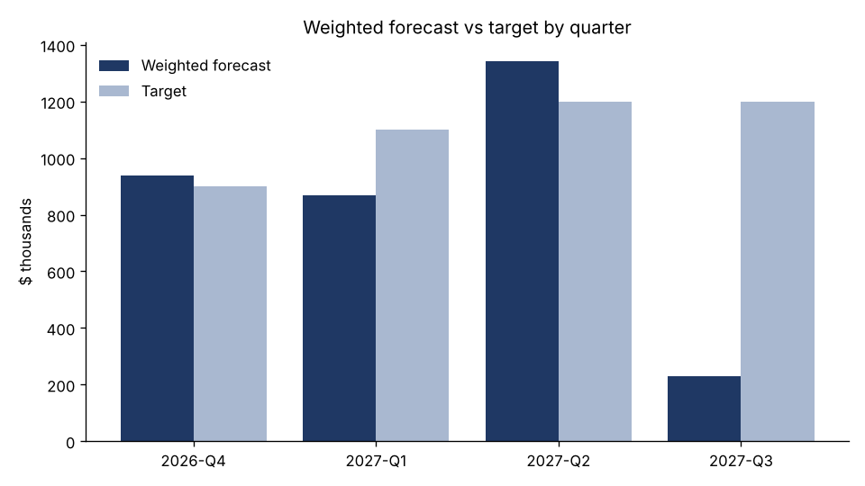

# Strategic Account Planning Toolkit — Life Insurance & Annuity


A working model of how a strategic account executive runs a book of life insurance and annuity relationships: carriers, IMOs, BGAs and broker-dealers buying a distribution technology platform. It takes CRM-style data and produces what the role runs on every week:

- **Account health scores** with risk flags and renewal-at-risk alerts
- **MEDDPICC qualification** for every open deal, with stage gaps turned into next actions
- **A weighted forecast** by quarter, with Commit / Best Case / Pipeline categories, coverage against target and stalled-deal alerts
- **Mutual Action Plans** worked backward from each late-stage deal's close date
- **Strategic account plans** with a business review agenda for every account

All data is synthetic and seeded, so every run produces the same book. The generator plants known situations (a red account with a renewal in 75 days, a deal in negotiation with no economic buyer, a stalled expansion), and the tests check that the toolkit catches each one.

## What a run produces

```
Accounts: 16 (11 clients)
Open opportunities: 22 | weighted pipeline $3,429,969
Renewals at risk: Summit Mutual, Crestview Annuity Marketing
Deals at risk on qualification: 3
Stalled deals: 5
```

| Output | What's in it |
|---|---|
| [`output/account_strategy_workbook.xlsx`](output/account_strategy_workbook.xlsx) | Forecast summary, pipeline, account health, MEDDPICC, whitespace and Mutual Action Plan sheets |
| [`output/account_plans/`](output/account_plans) | One strategic account plan per account, e.g. [Summit Mutual](output/account_plans/A002_Summit_Mutual.md) (red, renewal at risk) and [Keystone Annuity Co.](output/account_plans/A003_Keystone_Annuity_Co.md) (late-stage deal missing its economic buyer) |
| [`output/forecast_vs_target.png`](output/forecast_vs_target.png) | Weighted forecast against target by quarter |



## How it works

### Account health (`src/health.py`)
Each client gets a 0–100 score from five weighted signals:

| Signal | Weight | Source |
|---|---|---|
| Adoption | 25% | Share of licensed seats in use |
| Momentum | 20% | Usage trend over the last two quarters |
| Sentiment | 20% | NPS |
| Support | 15% | Open escalations |
| Executive access | 20% | Days since the last meeting with the economic buyer |

70+ is Green, 50–69 Yellow, under 50 Red. A Red account renewing within 180 days is flagged as a renewal at risk, and its account plan opens with a retention plan. The whitespace view lists the platform modules each client has not yet adopted, which is the expansion map.

### MEDDPICC qualification (`src/meddpicc.py`)
Each element (Metrics, Economic Buyer, Decision Criteria, Decision Process, Paper Process, Identify Pain, Champion, Competition) is scored 0 (unknown), 1 (partly confirmed) or 2 (confirmed). Every stage has elements that should already be confirmed; for example, nothing should be in Negotiation without a confirmed economic buyer and paper process. A deal missing what its stage requires is marked At Risk, and each gap becomes a specific next action.

### Forecast (`src/forecast.py`)
Stage probabilities are adjusted by qualification (At Risk ×0.6, Qualified ×1.1) and, for renewals and expansions, by account health (Yellow ×0.9, Red ×0.6). Negotiation-stage deals that are qualified at a healthy account are Commit; the rest of Business Case and Negotiation is Best Case. The summary rolls up by quarter with pipeline coverage and the gap to target, and deals that have sat in a stage too long are flagged as stalled.

### Mutual Action Plans (`src/action_plan.py`)
For every Business Case and Negotiation deal, the toolkit lays out the joint path to signature and kickoff: business case, demo, integration and data review, information security review, compliance review of suitability and e-application workflows, pricing, legal, signature and implementation kickoff. Each step has a client owner, a vendor owner and business-day dates. If the remaining time can't fit the steps, the plan is marked Compressed and shows the realistic signature date.

## Run it

```bash
pip install -r requirements.txt
python run.py      # writes data/ and output/
pytest             # 25 tests
```

## Project layout

```
src/data_gen.py      synthetic accounts, contacts, opportunities and activities
src/health.py        account health, risk flags, whitespace
src/meddpicc.py      deal qualification and next actions
src/forecast.py      weighted forecast, categories, stalled deals, quarterly summary
src/action_plan.py   Mutual Action Plan builder
src/account_plan.py  strategic account plan and business review pack
run.py               runs everything and writes the outputs
tests/               tests, including checks for every planted situation
```
